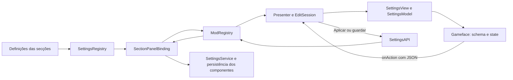

# Relatório funcional do painel de configuração

**Projeto:** Driftkings SettingsLab  
**Data:** 2026-10-27  
**Referência analisada:** branch `develop`, integração do painel redesenhado iniciada em `1a5b021`.

O painel **DriftkingsModSettings** centraliza a edição das definições registadas pelos componentes. Apresenta controlos, valida os valores, encaminha alterações para os serviços dos mods e gere a gravação, perfis, pré-visualizações, atualizações e reinícios. As funções descritas foram verificadas no código; a disponibilidade efetiva das páginas depende dos componentes carregados e do contexto do cliente.

## 1. Abertura e contexto

- Regista uma entrada Driftkings na API ModsList, quando esta integração está disponível.
- Permite abertura pelo atalho configurável `openKey` e pela API `settings.open()`.
- Mantém uma única janela; chamadas de abertura repetidas não criam cópias.
- Abre no lobby autenticado e, em batalha/replay, quando o jogador tem uma arena válida. O registo da entrada ModsList no login não altera esta condição: o controller não abre a janela nesse contexto.
- O atalho, com a janela aberta, segue o fluxo de fecho e confirmação de alterações.
- Ao mudar de contexto, fecha a janela e liberta listeners, callbacks de captura, previews e sessão de edição.

**Código:** [SettingsService](../mod/res/scripts/client/driftkings/settings/__init__.py), [SettingsController](../mod/res/scripts/client/driftkings/gameface/lobby/settings_window.py).

## 2. Navegação e informação apresentada

| Função | Comportamento |
| --- | --- |
| Lista lateral | Permite recolher categorias e apresenta contadores de alterações. Agrupa páginas por categoria: geral, batalha, hangar/lobby e sistema; admite categorias adicionais declaradas pelos módulos. |
| Pesquisa | Filtra páginas e controlos pelo texto apresentado, sem alterar as configurações. |
| Separadores | Mostra os grupos declarados por cada página e a opção de consultar todos. |
| Cabeçalho | Inclui interruptor de ativação do módulo; apresenta nome, categoria, autor, versão e descrição quando estes metadados existem. |
| Estado | Mostra ativação, problemas de configuração, dependências e necessidade de reinício. |
| Compatibilidade | Apresenta avisos de conflitos confirmados ou possíveis fornecidos pelo serviço de compatibilidade. |
| Mods instalados | Abre um resumo dos módulos conhecidos pelo painel e respetivos estados; a informação vem do registo, não de uma pesquisa geral de todos os ficheiros do jogo. |
| Mensagens | Mostra confirmações/erros temporários e permite abrir a mensagem num diálogo para leitura. |
| Comunidade | Disponibiliza ligação Discord através de uma ação com endereço definido no código. |
| Layout | Adapta escala e dimensões à área do cliente, organiza os controlos por secções numa lista com coluna de detalhe e gere scrollbars. |

**Código:** [app.js](../mod/res/gui/gameface/mods/driftkings/settings_window/js/app.js), [layout.py](../mod/res/scripts/client/driftkings/settings/panel/layout.py), [presenter.py](../mod/res/scripts/client/driftkings/settings/panel/presenter.py).

## 3. Edição, Aplicar, Guardar e Cancelar

A camada `EditSession` representa rascunhos, valores publicados e valores guardados. **Na API atualmente usada pela janela, `apply_session()` chama `session.save()`: o botão Aplicar também persiste os valores.** A documentação deve seguir este comportamento efetivo, além dos comentários internos da sessão.

| Operação | Efeito atual |
| --- | --- |
| Alterar um controlo | Valida e coloca o valor no rascunho. Alterações visuais locais, como tema e amostra de marcadores, podem ser pré-visualizadas. |
| Aplicar | Aplica os rascunhos, grava as alterações e mantém a janela aberta. Pode apresentar pedido de reinício. |
| Guardar e aplicar | Executa a mesma gravação/aplicação e pede fecho da janela; um pedido de reinício pode manter o diálogo aberto. |
| Cancelar | Limpa rascunhos e histórico desde a última aplicação; mantém a janela aberta. Uma alteração já gravada por Aplicar mantém-se. |
| Desfazer | Recupera o rascunho anterior; o histórico mantém até 50 estados. Aplicar/gravar limpa esse histórico. |
| Repor predefinições | Coloca os valores predefinidos da página no rascunho. Preserva segredos e controlos desativados. |
| Repor uma opção | O botão junto do controlo repõe apenas o respetivo valor predefinido no rascunho. |
| Repor tema | Repõe os campos de aparência do painel numa operação de histórico. |
| Fechar com alterações pendentes | Pergunta se pretende guardar, descartar ou continuar a editar. |
| Descartar no diálogo de fecho | Descarta rascunhos e repõe valores publicados ainda diferentes do estado guardado. Os valores já persistidos por Aplicar são a referência guardada. |
| Fecho imposto pelo cliente | Executa a limpeza da sessão e descarta alterações ainda não guardadas. |
| Erro de gravação | Apresenta uma mensagem de falha e não segue o fecho normal de gravação bem-sucedida. |

As secções integradas persistem através do serviço de configurações de cada componente. A aplicação não constitui uma transação global entre todos os componentes: uma falha a meio de várias gravações pode deixar alterações anteriores já persistidas.

**Código:** [SettingsAPI.apply_session/save_session](../mod/res/scripts/client/driftkings/settings/panel/api.py), [EditSession](../mod/res/scripts/client/driftkings/settings/panel/session.py), [ModRegistry](../mod/res/scripts/client/driftkings/settings/panel/registry.py), [SectionPanelBinding.apply](../mod/res/scripts/client/driftkings/settings/panel/sections.py).

## 4. Tipos de controlos e validação

A API disponibiliza os seguintes tipos; cada página utiliza o subconjunto que declara:

| Grupo | Capacidades |
| --- | --- |
| Ativação | Switch e checkbox. |
| Seleção | Dropdown e seleção múltipla; apresentação de opções com metadados/imagens quando declaradas. |
| Valores numéricos | Slider, entrada numérica, limites, passos, unidades e atalhos de teclado do controlo. |
| Texto | Texto simples e área de texto; JSON estruturado quando a definição da secção o declara. |
| Cores | Seletor de espectro original (canvas, comparação atual/nova, HEX e opacidade), presets e valores hexadecimais com `#`; nas configurações integradas usa-se `#RRGGBB`. Campos alfa associados podem ser editados juntamente com a cor. |
| Teclas | Captura de códigos nativos e combinações, apresentação dos nomes e limpeza da combinação. Escape cancela a captura; modificadores isolados dependem da declaração do controlo. |
| Segredos | Campo password, indicação de existência e limpeza explícita; o valor armazenado não é enviado no estado da UI nem incluído nos snapshots exportados. |
| Caminhos | Tipos `file` e `directory`, apresentados atualmente como campos de texto. |
| Organização | Secções, labels, separadores e tabs; os metadados de colunas são preservados no contrato Python. |
| Ações | Botões com callbacks registados pelo módulo; podem devolver uma mensagem para o painel. |

O backend verifica tipos, números finitos, intervalos, opções, limites de texto, códigos de tecla e dependências. Controlos desativados e valores inválidos são rejeitados. A normalização específica do componente ocorre antes de persistir as suas configurações. Identificadores desconhecidos não são aceites como novas opções.

Durante a captura de teclas, o controller combina eventos nativos com polling temporário de 20 ms, porque o Gameface pode consumir o input. O polling termina ao concluir/cancelar a captura ou ao destruir a janela.

**Código:** [controls.py](../mod/res/scripts/client/driftkings/settings/panel/controls.py), [controls.js](../mod/res/gui/gameface/mods/driftkings/settings_window/js/controls.js), [color_picker.js](../mod/res/gui/gameface/mods/driftkings/settings_window/js/color_picker.js), [settings_window.py](../mod/res/scripts/client/driftkings/gameface/lobby/settings_window.py).

## 5. Pré-visualizações

### Imagens e sons

- Mostra imagens de opções e ficheiros locais compatíveis.
- Aceita recursos GUI e imagens PNG/JPEG em caminhos autorizados de `mods/configs`; as imagens locais estão limitadas a 2 MiB e são verificadas pelo conteúdo.
- Mantém um cache limitado e limpa-o ao fechar a sessão. A resolução de previews não descarrega imagens remotas.
- Disponibiliza reprodução/paragem de eventos Wwise registados. O Sexto Sentido liga os botões de audição ao evento selecionado no rascunho.
- A audição não depende de ativar o som em batalha. Trocar de página, editar a seleção de som ou fechar o painel interrompe o preview.
- O gestor de preview usa bancos existentes e informa eventos/bancos indisponíveis; o registo de preview não reescreve os bancos originais.

**Código:** [media.py](../mod/res/scripts/client/driftkings/settings/panel/media.py), [sound.py](../mod/res/scripts/client/driftkings/settings/panel/sound.py), [sections.py](../mod/res/scripts/client/driftkings/settings/panel/sections.py).

### Editor de marcadores dos veículos

O editor redesenhado apresenta um tanque e um formulário por elemento:

- Contextos aliado/adversário, vivo/destruído e normal/ALT, com ficheiros independentes.
- Amostras de vida a 100%, 75%, 40% e 10%; cores de equipa, vida e rating resolvidas pelo modelo partilhado.
- Campos de texto: criação, remoção, formatação, fonte e posição; permite acrescentar o primeiro campo a listas vazias.
- Formulários da barra de vida, dano, ícones, distância e opções gerais, incluindo cores herdadas.
- Edição de modelos partilhados `def.*` e edição JSON dos documentos.
- Scrollbar próprio nas propriedades; o seletor de cores é o original do projeto.
- Os rascunhos de documentos são cópias. Uma rejeição pelo Python repõe a referência autoritativa e não altera o cache da amostra.

A pré-visualização usa os macros, paletas e fontes do projeto. É uma aproximação no Gameface; não reproduz a animação de dano ou todas as variantes do renderer Flash. O formulário/JSON permite configurar esses valores para a próxima batalha. Aplicar e Guardar seguem o comportamento de persistência descrito na secção 3.

**Código:** [VehicleMarkersSettings](../mod/res/scripts/client/driftkings/settings/definitions/battle/vehicle_markers.py), [markers.js](../mod/res/gui/gameface/mods/driftkings/settings_window/js/markers.js), [vehicle_markers_model.js](../mod/res/gui/gameface/mods/driftkings/settings_window/js/vehicle_markers_model.js). Ver também o [guia de marcadores](vehicle_markers/README.md).

### Pré-visualizações adicionais do novo painel

- **Minimapa:** mapa de 1000 m, veículos e alcances de exemplo; reage a círculos, linhas, ícones, HP, etiquetas e modo alternativo.
- **Posição no ecrã:** cena de batalha ou lobby a 1920×1080, com o módulo selecionado destacado e opção de ampliar.
- **Texto formatado:** HTML e macros preenchidos com valores de exemplo, preservando os nomes das fontes.
- **Carrossel:** cartões normais/compactos com veículos e estatísticas de exemplo, campos nativos e extras.
- **Detalhe e revisão:** descrição, valores guardado/novo/predefinido, dependências e momento de aplicação; permite repor alterações individualmente.

As imagens são lidas dos recursos locais do cliente. As amostras não executam os módulos de combate nem demonstram equivalência visual em jogo. A inspeção gráfica desta integração continua pendente.

**Código:** [minimap.js](../mod/res/gui/gameface/mods/driftkings/settings_window/js/minimap.js), [hud.js](../mod/res/gui/gameface/mods/driftkings/settings_window/js/hud.js), [richtext.js](../mod/res/gui/gameface/mods/driftkings/settings_window/js/richtext.js), [carousel.js](../mod/res/gui/gameface/mods/driftkings/settings_window/js/carousel.js).

## 6. Perfis: dois mecanismos distintos

| Mecanismo | Finalidade e operações |
| --- | --- |
| Gestor de snapshots do painel | Criar um snapshot da sessão atual, carregar, renomear, eliminar com confirmação e importar/exportar JSON. Carregar/importar prepara rascunhos; os componentes só recebem os valores quando se aplica/grava. A operação backend `duplicate` também guarda um snapshot com outro nome; o diálogo atual apresenta o botão Criar. |
| Perfil ativo do projeto | A secção `driftkings` permite selecionar o perfil do loader ou copiar o atual através de `newProfile`. Persiste a seleção do perfil e apresenta a indicação de reinício. |

Os snapshots usam o formato `dk.settings.profile`, versão 1, com os módulos/opções conhecidos e sem segredos. A importação valida o documento antes de substituir os rascunhos. Os nomes de snapshot aceitam letras ASCII, números, `_` e `-`, até 64 caracteres, com rejeição de nomes reservados do Windows. Eliminar um snapshot guarda primeiro um backup limitado.

Perfis do painel são bloqueados em batalha. A exportação apresenta o JSON no diálogo e escreve também o ficheiro de exportação local.

**Código:** [Profiles do painel](../mod/res/scripts/client/driftkings/settings/panel/profiles.py), [diálogo em app.js](../mod/res/gui/gameface/mods/driftkings/settings_window/js/app.js), [ProfileSettings do loader](../mod/res/scripts/client/driftkings/settings/profiles.py).

## 7. Aparência e opções do próprio painel

A página `dk.settings` contém:

| Opção | Valores/predefinição declarados |
| --- | --- |
| Idioma | Automático ou idioma disponível; os catálogos do projeto abrangem 18 idiomas. |
| Atalho de abertura | Configurável; predefinição com código nativo `68`. |
| Tema | WoT, escuro, preto, transparente ou personalizado. |
| Cores | Destaque e, no tema personalizado, fundo, texto, texto secundário, bordas e hover. |
| Opacidade da janela | 20–100%, predefinição 94%. |
| Opacidade lateral | 0–100%, predefinição 35%. |
| Escala | 80–140%, predefinição 140%. |
| Tamanho do texto | 12–20, predefinição 15. |
| Tamanho dos títulos de secção | 14–26, predefinição 18. |
| Diagnóstico | Desativado por predefinição; ativa informação de diagnóstico do painel. |
| Atualizações | Verificação automática e canal stable/beta; canal declarado por predefinição: stable. |
| Analytics | Opção de participação, desativada por predefinição. |

O tema transparente limita a opacidade efetiva a 75%. A aparência tem preview no rascunho, podendo ser reposta antes de gravar. A preferência de idioma atualiza os rótulos e a estrutura sem perder os rascunhos, fechando os diálogos anteriores. Os textos novos estão nos mesmos 18 catálogos YAML, com 243 chaves de painel; a revisão terminológica por falantes nativos continua recomendada.

**Código:** [core_page.py](../mod/res/scripts/client/driftkings/settings/panel/core_page.py), [themes.py](../mod/res/scripts/client/driftkings/settings/panel/themes.py).

## 8. Atualizações, reinício e diagnóstico

- Mostra versão instalada, canal, última verificação, estado, nova versão e changelog quando estes dados são fornecidos pelo updater.
- Permite verificar, descarregar, cancelar o descarregamento, programar/cancelar a instalação e abrir a página oficial de releases.
- Permite pedir reinício para uma atualização preparada ou adiá-lo.
- O updater e o controller voltam a verificar permissões/estado antes de reiniciar. O painel bloqueia reinício durante batalha e com alterações por guardar.
- Mudanças de componentes que exigem reinício são assinaladas através de `restart_required`; as que têm efeito na próxima batalha/view recebem uma descrição desse prazo.
- Em debug, mostra versão do framework/jogo, quantidade de módulos registados, estado dos bancos de som, métricas de diagnóstico e callbacks.

O painel encaminha pedidos; a verificação do pacote e a execução da atualização pertencem ao serviço updater. O registo de eventos de diagnóstico e o serviço de analytics têm responsabilidades separadas da edição de configurações.

**Código:** [ações do Presenter](../mod/res/scripts/client/driftkings/settings/panel/presenter.py), [atualizações em app.js](../mod/res/gui/gameface/mods/driftkings/settings_window/js/app.js), [restart do controller](../mod/res/scripts/client/driftkings/gameface/lobby/settings_window.py).

## 9. Restrições e momento de aplicação

As secções de componentes têm quatro momentos possíveis: imediato (`live`), próxima batalha (`battle`), próxima view (`view`) e reinício (`restart`). O serviço de metadados define o momento por opção; opções desconhecidas usam a política de reinício.

Durante batalha/replay, o binding só disponibiliza as secções de **indicador de autoaim**, **informações do alvo** e **painéis das equipas/carregamento**. Dentro delas, apenas campos classificados como `live` podem ser editados. A página própria do framework tem o seu registo separado; os pedidos de reinício e perfis continuam sujeitos às restrições específicas.

Uma configuração gravada para a próxima batalha não altera retroativamente a instância de marcadores da batalha atual. A indicação de reinício não é uma medição de impacto no desempenho.

**Código:** [BATTLE_EDITABLE/APPLY_TIMING](../mod/res/scripts/client/driftkings/settings/settings_data.py), [SectionPanelBinding.populate](../mod/res/scripts/client/driftkings/settings/panel/sections.py).

## 10. Áreas de configuração dos componentes

Existem **34 ficheiros de definição**: quatro gerais, 23 de batalha e sete de lobby. Acrescem a página do framework e o seletor de perfil do loader. Um componente pode originar vários blocos/separadores; esta contagem não é uma promessa de 36 páginas sempre visíveis. Componentes desativados pelo loader, ausentes numa instalação ou omitidos no contexto atual podem não aparecer.

As tabelas seguintes descrevem o âmbito das definições; ativar uma função na configuração não garante suporte de todos os modos de jogo.

### Geral

| Definição | Nome apresentado em português | Âmbito |
| --- | --- | --- |
| [`battle_performance`](../mod/res/scripts/client/driftkings/settings/definitions/components/battle_performance.py) | Desempenho em batalha | Formatos, cores e apresentação da eficiência em batalha e nos resultados. |
| [`game_log_manager`](../mod/res/scripts/client/driftkings/settings/definitions/components/game_log_manager.py) | Registo de danos em batalha | Troca dos logs superior/inferior e filtros de críticos, bloqueio e assistência. |
| [`main`](../mod/res/scripts/client/driftkings/settings/definitions/components/main.py) | Definições gerais | Relógio do lobby e lista de campos posicionados, respetivo texto, sombra e imagem de fundo. |
| [`sound_bank_loader`](../mod/res/scripts/client/driftkings/settings/definitions/components/sound_bank_loader.py) | Carregamento de bancos de som | Opções declaradas automaticamente para a integração de bancos de som. |

### Batalha

| Definição | Nome apresentado em português | Âmbito |
| --- | --- | --- |
| [`aiming_countdown`](../mod/res/scripts/client/driftkings/settings/definitions/battle/aiming_countdown.py) | Tempo de fecho da mira | Template, cores por progresso e posição do tempo de fecho da mira. |
| [`aiming_reticles`](../mod/res/scripts/client/driftkings/settings/definitions/battle/aiming_reticles.py) | Círculos de mira | Miras cliente/servidor, estilos, opacidade, dimensão mínima e correção. |
| [`artillery_blast_radius`](../mod/res/scripts/client/driftkings/settings/definitions/battle/artillery_blast_radius.py) | Raio de explosão da artilharia | Apresentação de ponto/raio de explosão, modos de câmara e teclas. |
| [`autoaim_target_indicator`](../mod/res/scripts/client/driftkings/settings/definitions/battle/autoaim_target_indicator.py) | Indicador do alvo da mira automática | Configuração do indicador de alvo da mira automática e cor. |
| [`battle_marks_of_excellence`](../mod/res/scripts/client/driftkings/settings/definitions/battle/battle_marks_of_excellence.py) | Marcas de excelência em batalha | Painel, metas, cores, dados apresentados, replay, base de aproximação e atalhos. |
| [`battle_preferences`](../mod/res/scripts/client/driftkings/settings/definitions/battle/battle_preferences.py) | Opções de batalha | Elementos da interface, sons, chat, névoa, relógio de batalha e outras preferências declaradas. |
| [`battle_statistics`](../mod/res/scripts/client/driftkings/settings/definitions/battle/battle_statistics.py) | Estatísticas de batalha | Formato, paleta e apresentação das estatísticas de batalha. |
| [`enemy_spotting_status`](../mod/res/scripts/client/driftkings/settings/definitions/battle/enemy_spotting_status.py) | Notificações de deteção e assistência | Textos, cores, ícones e som das notificações de deteção/assistência. |
| [`gun_traverse_limits`](../mod/res/scripts/client/driftkings/settings/definitions/battle/gun_traverse_limits.py) | Limites de rotação da arma | Apresentação dos limites horizontais e verticais da arma. |
| [`high_caliber_progress`](../mod/res/scripts/client/driftkings/settings/definitions/battle/high_caliber_progress.py) | Progresso de Grande Calibre | Configuração visual do progresso de Grande Calibre e fundo do painel. |
| [`minimap_enhancements`](../mod/res/scripts/client/driftkings/settings/definitions/battle/minimap_enhancements.py) | Melhorias do minimapa | Nomes, posições perdidas, linhas, círculos, vida, ícones, zoom, tamanho do mapa e tecla ALT. |
| [`penetration_indicator`](../mod/res/scripts/client/driftkings/settings/definitions/battle/penetration_indicator.py) | Indicador de penetração | Apresentação do indicador e inclusão de veículos aliados. |
| [`repair_controls`](../mod/res/scripts/client/driftkings/settings/definitions/battle/repair_controls.py) | Controlos de reparação | Teclas e regras de consumíveis/reparação, tripulação, incêndio, atordoamento e chassis. |
| [`server_turret_sync`](../mod/res/scripts/client/driftkings/settings/definitions/battle/server_turret_sync.py) | Sincronização da torre com o servidor | Sincronização da torre com o servidor e mensagem de ativação. |
| [`shell_flight_time`](../mod/res/scripts/client/driftkings/settings/definitions/battle/shell_flight_time.py) | Tempo de voo do projétil | Template, posição e restrição do tempo de voo a artilharia. |
| [`sixth_sense_alert`](../mod/res/scripts/client/driftkings/settings/definitions/battle/sixth_sense_alert.py) | Alerta de Sexto Sentido | Ícone, timer, duração, eventos de som, audição e mensagens de ajuda/deteção. |
| [`sniper_camera`](../mod/res/scripts/client/driftkings/settings/definitions/battle/sniper_camera.py) | Câmara de precisão | Efeitos e comportamento da câmara de precisão, incluindo saída após disparo. |
| [`target_distance`](../mod/res/scripts/client/driftkings/settings/definitions/battle/target_distance.py) | Distância ao alvo | Alvos, modo de apresentação, âncora, offsets, bloqueio, precisão e estilo do texto. |
| [`target_information`](../mod/res/scripts/client/driftkings/settings/definitions/battle/target_information.py) | Informações do alvo | Template, alvo elegível, tecla alternativa, atraso, fundo e posição. |
| [`team_panels`](../mod/res/scripts/client/driftkings/settings/definitions/battle/team_panels.py) | Painéis das equipas e carregamento | Perfis de layout, templates, HP, deteção, ratings e variantes painel/carregamento/TAB. |
| [`third_person_zoom`](../mod/res/scripts/client/driftkings/settings/definitions/battle/third_person_zoom.py) | Zoom da câmara exterior | Configuração dos modos/valores do zoom exterior. |
| [`vehicle_health`](../mod/res/scripts/client/driftkings/settings/definitions/battle/vehicle_health.py) | Pontos de vida do veículo | Apresentação dos pontos de vida e posição. |
| [`vehicle_markers`](../mod/res/scripts/client/driftkings/settings/definitions/battle/vehicle_markers.py) | Marcadores dos veículos | Editor estruturado e amostra descritos na secção 5. |

### Lobby/hangar

| Definição | Nome apresentado em português | Âmbito |
| --- | --- | --- |
| [`clan_reward_collection`](../mod/res/scripts/client/driftkings/settings/definitions/lobby/clan_reward_collection.py) | Recolha de recompensas do clã | Configuração da ativação da recolha de recompensas do clã. |
| [`crew_management`](../mod/res/scripts/client/driftkings/settings/definitions/lobby/crew_management.py) | Gestão da tripulação | Retorno automático, notificações, exclusões e resumos de progressão/XP da tripulação. |
| [`hangar_marks_of_excellence`](../mod/res/scripts/client/driftkings/settings/definitions/lobby/hangar_marks_of_excellence.py) | Marcas de excelência no hangar | Painel do lobby, objetivos, histórico, cores, tooltips e posição. |
| [`hangar_preferences`](../mod/res/scripts/client/driftkings/settings/definitions/lobby/hangar_preferences.py) | Opções do hangar | Widgets/botões do lobby, munição, contadores, chat, login e opções relacionadas. |
| [`profile_ratings`](../mod/res/scripts/client/driftkings/settings/definitions/lobby/profile_ratings.py) | Ratings do registo de serviço | WN8, cores e limites de sobrevivência/dano recebido no registo de serviço. |
| [`tech_tree_marks_of_excellence`](../mod/res/scripts/client/driftkings/settings/definitions/lobby/tech_tree_marks_of_excellence.py) | Marcas de excelência na árvore tecnológica | Marcas, mestria, nomes coloridos e offsets dos indicadores na árvore. |
| [`vehicle_carousel`](../mod/res/scripts/client/driftkings/settings/definitions/lobby/vehicle_carousel.py) | Carrossel de veículos | Campos estatísticos, ordenação, nações/tipos, imagens e layout do carrossel. |

## 11. Ações recebidas pelo backend

Inventário das 23 ações tratadas pelo `Presenter.handle()` na referência analisada:

| Ação | Função |
| --- | --- |
| `select` | Selecionar página e parar a audição anterior. |
| `set` | Validar/editar um valor, incluindo cor e alfa associado quando declarados. |
| `reset` | Repor a página no rascunho. |
| `reset_theme` | Repor campos de aparência. |
| `undo` | Desfazer um estado de rascunho. |
| `cancel` | Limpar rascunhos e histórico. |
| `apply` | Aplicar/gravar e manter a janela. |
| `save` | Aplicar/gravar e seguir o fluxo de fecho/reinício. |
| `close` | Pedir fecho, com confirmação se necessário. |
| `confirm` | Guardar, descartar ou continuar a editar. |
| `button` | Executar callback de ação registado pelo módulo. |
| `capture` | Iniciar captura de uma combinação de teclas. |
| `profile` | Gerir snapshots e importar/exportar valores. |
| `restart` | Confirmar reinício agora ou mais tarde. |
| `check_updates` | Pedir verificação manual ao updater. |
| `download_update` | Pedir descarregamento. |
| `cancel_update_download` | Cancelar descarregamento. |
| `schedule_update` | Programar instalação. |
| `cancel_update_install` | Cancelar instalação programada. |
| `restart_update` | Abrir confirmação de reinício para atualização preparada. |
| `defer_update` | Adiar reinício da atualização. |
| `manual_update` | Abrir a página oficial de releases. |
| `open_discord` | Abrir o endereço de comunidade definido no código. |

A audição de som chega através de `button` e dos callbacks registados, sem uma ação genérica que execute eventos arbitrários recebidos da UI.

## 12. Organização técnica e fluxo de dados

| Camada | Responsabilidade e funções principais |
| --- | --- |
| [settings/__init__.py](../mod/res/scripts/client/driftkings/settings/__init__.py) | Iniciar/parar o serviço, ligar ModsList, perfil do loader, controller e contextos. |
| [gameface/lobby/settings_window.py](../mod/res/scripts/client/driftkings/gameface/lobby/settings_window.py) | `open`, `close`, `canOpen`, `restart`, `onKey`, `push`, `onAction`, captura e lifecycle Wulf. |
| [panel/presenter.py](../mod/res/scripts/client/driftkings/settings/panel/presenter.py) | `schema`, `state`, `theme`, `diagnostics`, `handle` e encaminhamento das ações. |
| [panel/session.py](../mod/res/scripts/client/driftkings/settings/panel/session.py) | `set`, `values`, `reset`, `undo`, `cancel`, `apply`, `save`, `discard` e cálculo de dependências/alterações. |
| [panel/api.py](../mod/res/scripts/client/driftkings/settings/panel/api.py) | API pública: `register_mod`, `register_sound_mod`, `mod`, `get`, `open`, idioma e aplicação/gravação da sessão. |
| [panel/registry.py](../mod/res/scripts/client/driftkings/settings/panel/registry.py) | Declaração de controlos `add_*`, `on_change`, `apply_values`, `save` e `run_button`; estado e metadados dos módulos. |
| [panel/sections.py](../mod/res/scripts/client/driftkings/settings/panel/sections.py) | Adaptar definições existentes: `populate`, `apply`, `relabel` e `dispose`. |
| [panel/profiles.py](../mod/res/scripts/client/driftkings/settings/panel/profiles.py) | `names`, `export`, `stage`, `save`, `load`, `rename` e `delete` dos snapshots. |
| [panel/storage.py](../mod/res/scripts/client/driftkings/settings/panel/storage.py) | JSON, escrita temporária/substituição, recuperação e backups limitados quando solicitados. |
| [panel/media.py](../mod/res/scripts/client/driftkings/settings/panel/media.py) | Resolver/cachear previews de imagem. |
| [panel/sound.py](../mod/res/scripts/client/driftkings/settings/panel/sound.py) | Registar eventos/bancos, consultar estado e reproduzir/parar previews. |
| [settings_window/js](../mod/res/gui/gameface/mods/driftkings/settings_window/js) | DOM, controlos, modais, tema, perfis, editor de marcadores e atualização visual do estado. |

O `SettingsModel` transporta duas propriedades JSON (`schema` e `state`) e o comando `onAction`. O schema muda com a estrutura/idioma; o estado acompanha valores, seleção, validação e updater. O frontend aplica patches aos controlos e reutiliza a geometria quando não muda, agrupa a atualização das barras de scroll e só reconstrói a página ao mudar de módulo/schema.

## 13. Persistência, proteção de dados e limites

- A infraestrutura do painel usa `mods/configs/driftkings/.settings`; os snapshots ficam em `profiles/` e as exportações em `exports/` sob essa raiz.
- A configuração dos componentes é persistida pelos respetivos owners/stores e pelo perfil ativo do projeto. Os marcadores usam o seu store de vários documentos.
- Campos secretos são separados em `secrets/` nos módulos geridos pelo store genérico; o estado da UI recebe apenas a indicação de que existe um valor.
- Importar snapshots não introduz módulos/opções desconhecidos nem valores secretos.
- O bridge exige um objeto JSON válido e limita o texto do pedido a 2 097 152 caracteres.
- Caminhos, nomes de ficheiros e previews têm validação própria. Os backups são limitados e explícitos; o painel não apresenta uma gestão universal de backups de todas as configurações.
- As ações de módulos podem normalizar configurações e exigir reinício. A interface assinala dependências, estado e erros para apoiar essa decisão.

## 14. Base e limites deste relatório

Foram consultados os módulos Python do painel, a integração Wulf, os recursos JavaScript/CSS da janela, o serviço de configurações, as 34 definições e os rótulos portugueses. As ligações acima apontam para as fontes da implementação analisada.

O relatório acompanha a integração da interface redesenhada. Os testes abrem 35 páginas e 1104 controlos reais em DOM simulado e verificam o contrato do seletor original. Não foram alterados perfis instalados; não constitui validação visual no cliente. As áreas que mais exigem aceitação em jogo são captura de teclas, scroll/escala, previews de marcadores/fontes, aplicação dependente de contexto e reinícios coordenados.
