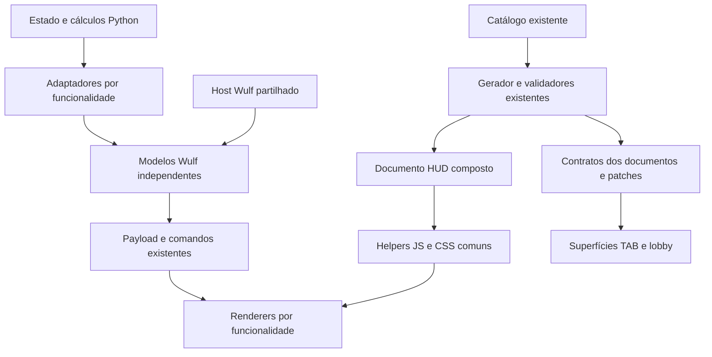

# Driftkings SettingsLab — Plano diretor de reorganização

Para o estado atual da candidata de produção e os checkpoints desta fase, ver o [registo v0.1.7-beta.2](../releases/0.1.7-beta.2-readiness.md). Os checkpoints datados abaixo mantêm os resultados e as versões originais.

Data de criação: 2026-11-11, Europe/Lisbon. Tipo: plano técnico; não é autorização de execução.

> Estado de leitura — 2026-11-15: as secções originais abaixo preservam o plano e
> a baseline da sua criação; estados iniciais `PENDING` e autorizações históricas
> não substituem o registo posterior. F0–F6 têm os resultados delimitados no
> progresso; C1–C6 foram criados localmente. C7 está em preparação documental,
> sem commit. Fase 7 permanece `IN_PROGRESS`; integração em `develop`, validação
> EU e release pública continuam pendentes e exigem autorização própria.
> Consultar a secção 43 do progresso para a separação C1–C7 e evidências atuais.

Documento de controlo: [progresso, decisões e aprovações](DRIFTKINGS_REORGANIZATION_PROGRESS.md).
Uma futura sessão deve ler ambos os documentos antes de propor ou executar trabalho.

## 1. Mandato e limites

Este plano orienta uma reorganização profunda e incremental do repositório
`dkruben/Driftkings_SettingsLab`. Nesta redação foram autorizadas apenas leitura,
criação dos dois documentos do plano, revisão e verificação do diff documental.
Nenhuma fase abaixo foi iniciada, implementada ou aprovada para implementação.

Objetivos: modularidade; nomenclatura descritiva; fronteiras claras entre lógica
Python, Wulf, Gameface e Flash/Scaleform; assets organizados por funcionalidade;
menos duplicações e legado; lifecycle previsível; contratos coerentes com o catálogo;
build e distribuição reproduzíveis; independência externa demonstrada; compatibilidade
verificável por versão, build e região.

Preservar cálculos, comportamento e identidade visual, salvo decisão explícita.
Podem ser propostas incompatibilidades com configurações antigas, mas cada uma exige
justificação, aprovação, estratégia de transição e rollback conjunto de código e dados.
Não renomear configurações já corretamente nomeadas apenas por aparência uniforme.

## 2. Referência confirmada nesta redação

| Facto | Valor ou evidência |
|---|---|
| Branch | `feature/wot-2.4.2-ct` |
| HEAD | `bebe4cc5bd24a529d160a8c1ac2c58f79b8015d3` |
| Working tree anterior a estes documentos | 44 caminhos pendentes; staging vazio |
| Experimento | `0.1.8-beta.9` |
| SHA-256 do pacote produzido e instalado | `22ed682634dfe84137a2f8ac775dc3ea1d1bb72544a2e01791fa88b5190b97e9` |
| Catálogo | 20 nativos, 0 consumidores OpenWG, 2 janelas próprias do lobby |
| Transportes dos 20 | 9 `own_window`, 6 `native_document`, 4 `native_user_missions`, 1 `native_battle_results` |
| Batalha | Nove modelos/cartões independentes numa janela Wulf/Gameface partilhada |
| Cliente de referência | World of Tanks CT 2.4.2.0 Common Test #995 |
| Runtime beta.9 | Pendente; não inferir aprovação a partir de testes automatizados |
| Independência sem OpenWG | Pendente; a biblioteca continua instalada |
| Servidor CT | Indisponibilidade comunicada pelo responsável; não verificada por acesso ao servidor nesta redação |

Pacote relativo ao repositório:
`build/experiments/20261111T115234Z-1d26e1e9/output/driftkings.wotmod`.

Pacote instalado de referência:
`C:/Games/World_of_Tanks_CT/mods/2.4.2.0 Common Test/driftkings.wotmod`.

Evidências já existentes, lidas sem executar nova regressão:

- `build/experiments/20261111T115234Z-1d26e1e9/diagnostics/install-record.json`.
- `build/experiments/20261111T115234Z-1d26e1e9/diagnostics/package-audit.json`.
- `build/experiments/20261111T115234Z-1d26e1e9/diagnostics/packaged-contracts.log`:
  dez contratos direcionados do pacote aprovados.
- A regressão anterior executou 936 testes Python 3, com um ignorado, e 691 Python 2.7.
  Uma expectativa antiga do TAB Halloween falhou; após correção autorizada,
  o ficheiro afetado passou nos oito testes em ambos os interpretadores.
  Não foi repetida uma segunda regressão completa.
- Frontend: 29 suites; ESLint, isort e validações de catálogo/assets/configurações
  aprovados no registo anterior. Estes resultados não equivalem a validação CT.

A beta.9 é a base de referência protegida para comparação. Não representa uma
declaração de `CT RUNTIME PASS` ou `OPENWG INDEPENDENCE PASS`.
Os artefactos, patches, configurações, backups e código correspondentes ficam intactos.
Os caminhos em `build/` podem ser ignorados pelo Git: não pressupor que existem noutra máquina.

## 3. Estrutura real e pontos de entrada

| Área existente | Responsabilidade e referências |
|---|---|
| `mod/res/scripts/client/driftkings/battle/`, `lobby/`, `components/`, `core/` | Funcionalidades, estado, cálculos, políticas e serviços Python |
| `mod/res/scripts/client/driftkings/gameface/` | Modelos Wulf, adaptadores e integração com superfícies |
| `mod/res/scripts/client/driftkings/flash/` | Adaptadores e contratos Flash/Scaleform com Python |
| `mod/res/gui/gameface/mods/driftkings/` | Renderers, documentos, estilos, helpers e plugins Gameface |
| `mod/res/gui/gen_resources/` | Declarações dos recursos nativos `R` |
| `mod/res/scripts/client/driftkings/interface_catalog.py` | Identidades, contexto, transporte, recursos, owners e assets |
| `build_tools/generate_ui_catalog.py` | Composição e validação do catálogo e documentos gerados |
| `build_data/build_config.json`, `components.json`, `patches/` | Pipeline, embalagem e contratos de compatibilidade |
| `flash_source/battle/`, `shared/`, `vehicle_markers/` | ActionScript, bibliotecas de referência e fontes dos SWF |
| `mod/res/gui/maps/`, `mod/res/gui/fonts/`, assets junto dos renderers | Recursos gráficos/fontes; confirmar consumidores antes de mover |
| `res/configs/driftkings/default/` | Configurações canónicas existentes; não uniformizar sem necessidade |
| `installer/` | Instalador e previews, distintos dos recursos distribuídos ao jogo |
| `tests/runtime/`, `tests/build/`, `tests/frontend/`, `tests/artifacts/` | Contratos e verificações proporcionais às alterações |
| `build/experiments/`, `build/backups/`, `build/unified/` | Outputs e referências protegidas; não são fontes a editar |

O catálogo é central, mas não substitui os contratos de recursos `R`, embalagem,
compatibilidade ou a seleção do host. A proposta deve reduzir manutenção repetida
por derivação e validação cruzada, sem criar uma segunda fonte de verdade.

### Fronteiras que devem orientar a reorganização

O Battle Observer pode inspirar organização e atribuição de responsabilidades.
Não copiar implementação, hooks, mecanismos de transporte ou contratos técnicos.

## 4. Regras de controlo e aprovação

### Uma fase de cada vez

Todas as fases começam em `PENDING`. É proibido iniciar a fase seguinte sem
autorização explícita do responsável. Uma fase tecnicamente aprovada nos testes não
autoriza trabalho adicional nem muda automaticamente o estado para `COMPLETE`.

Para cada mudança estrutural: inventariar/analisar; apresentar proposta delimitada;
aguardar aprovação; implementar só o aprovado; verificar proporcionalmente;
apresentar evidências; aguardar validação e nova autorização.

Uma autorização de análise não autoriza implementação. Autorizações de implementação
não autorizam automaticamente builds, instalações, commits ou publicações.
Se o âmbito mudar, parar a parte dependente e solicitar decisão explícita.

### Estados normalizados

| Estado | Significado |
|---|---|
| `PENDING` | Ainda não iniciado; sem autorização de execução |
| `IN_ANALYSIS` | Análise expressamente autorizada e em curso |
| `AWAITING_APPROVAL` | Proposta delimitada entregue; aguarda decisão |
| `APPROVED_FOR_IMPLEMENTATION` | Implementação do âmbito exato aprovada |
| `IN_PROGRESS` | Implementação aprovada em curso |
| `VALIDATION_PENDING` | Alteração entregue; faltam verificações ou confirmação |
| `BLOCKED` | Pré-requisito concreto em falta, documentado com condição de desbloqueio |
| `COMPLETE` | Critérios cumpridos e confirmação do responsável registada |
| `REJECTED` | Proposta rejeitada; âmbito não pode ser executado |

Fluxo típico: `PENDING` → `IN_ANALYSIS` → `AWAITING_APPROVAL` →
`APPROVED_FOR_IMPLEMENTATION` → `IN_PROGRESS` → `VALIDATION_PENDING` → `COMPLETE`.
Fases de análise podem terminar sem implementação, após aceitação do entregável.
O estado `BLOCKED` não permite saltar fases ou reduzir critérios sem autorização.
Se o CT estiver indisponível, registar a validação runtime pendente, sem inventar um PASS.

### Preservação e rastreabilidade

- Confirmar Git em todas as sessões; não assumir que os 44 caminhos continuam iguais.
- Não perder alterações, sobrescrever backups, executar reset/clean/stash ou commits sem autorização.
- Não editar outputs gerados manualmente nem substituir hashes históricos para ocultar falhas.
- Não apagar recursos sem identificar consumidores, incluindo utilização dinâmica e SWF.
- Não renomear globalmente sem mapa de referências e proposta aprovada.
- Não adicionar dependências externas, catálogo, loader, event bus ou publicação paralelos.
- Não substituir o host atual por nove janelas independentes.
- Não tratar limpeza textual de referências OpenWG como prova de independência runtime.
- Não remover ModsListAPI, ModsSettingsAPI ou pacotes externos por inferência.

### Ficha obrigatória de execução de cada fase

O registo de progresso deve conter objetivo, âmbito, ficheiros, pré-requisitos,
riscos, alterações autorizadas, critérios de aceitação, testes, rollback,
relatório final e estado de aprovação. Acrescentar a autorização literal ou referência
à mensagem, os limites, evidências, divergências e a decisão final do responsável.

## 5. Fase 0 — Baseline e preservação

**Estado inicial: `PENDING`. Próxima fase elegível para análise; não iniciada.**

- **Objetivo:** estabelecer uma baseline documentada, recuperável e verificável.
- **Âmbito:** branch, HEAD, working tree, staging, 44 caminhos pendentes, fontes,
  outputs, dependências, estrutura do `.wotmod`, experiências e backups.
- **Ficheiros envolvidos:** registo Git; `build/experiments/`, `build/backups/`,
  `build/unified/`; `build_data/`; pacote beta.9; configurações instaladas;
  os dois documentos deste plano. Inventariar todos os artefactos beta.9 na fase autorizada.
- **Pré-requisitos:** autorização explícita da análise; acesso às referências e espaço
  para preservação futura. A conferência mínima desta redação não conclui a Fase 0.
- **Riscos:** artefactos ignorados pelo Git; snapshots parciais; caminhos alterados
  entre sessões; commit isolado que não contém as migrações ainda pendentes.
- **Alterações autorizáveis após decisão:** inventário, hashes e estratégia de isolamento.
  Propor branch/worktree exclusiva e preservação da working tree completa; criar apenas
  se essa operação estiver explicitamente aprovada. Não pressupor que criar worktree
  transporta os ficheiros não commitados ou não rastreados.
- **Aceitação:** inventário completo, identificação de fontes/outputs/dependências,
  hashes críticos, mapa do pacote, procedimento de recuperação e estratégia de
  isolamento aprovados; nenhuma alteração perdida.
- **Verificações exigidas:** leituras Git, hashes, inventário ZIP e comparação das
  referências; não compilar nem repetir regressão para produzir o inventário.
- **Rollback:** preservar o estado original e snapshots exclusivos; futura recuperação
  deve incluir tracked, untracked, remoções intencionais, configurações e artefactos.
  Verificar hashes antes e depois; nunca executar restauração destrutiva por defeito.
- **Relatório final:** inventário, lacunas, hashes, estratégia proposta, prova de
  recuperabilidade e limites da validação runtime.
- **Aprovação:** sem autorização atual para iniciar a fase ou criar branch/worktree/commit.

## 6. Fase 1 — Inventário e nomenclatura global

**Estado inicial: `PENDING`.**

- **Objetivo:** propor convenções coerentes sem quebrar contratos do cliente.
- **Âmbito:** Python 2.7, Wulf/Gameface, JS/CSS/HTML, Flash/Scaleform, AS3, XML,
  JSON, assets, identificadores internos/públicos e ferramentas de build.
- **Ficheiros envolvidos:** áreas de fontes da secção 3, catálogo, `gen_resources`,
  definições de settings, macros, manifestos, fontes AS3 e referências em testes/docs.
- **Pré-requisitos:** baseline aceite; autorização desta análise; mapa de referências
  físicas, imports, URLs, aliases, propriedades Wulf, comandos e linkage AS3.
- **Riscos:** sensibilidade a maiúsculas, contratos públicos, aliases do motor,
  settings persistidos e nomes que designam funcionalidades diferentes.
- **Alterações autorizáveis após proposta:** somente renomeações enumeradas e
  transições de configuração justificadas, com todas as referências mapeadas.
  A entrega inicial é uma proposta; não uma renomeação automática.
- **Aceitação:** tabela completa e aprovada; exceções justificadas; lista explícita
  dos nomes/configurações que permanecem; impacto e rollback de cada alteração.
- **Testes exigidos:** resolução de imports/URLs/aliases, catálogo e embalagem,
  contratos de configurações e testes das superfícies afetadas; runtime quando
  houver mudança de recurso, linkage, identidade Wulf ou configuração funcional.
- **Rollback:** mapa inverso e snapshots correspondentes de código/configurações;
  nunca restaurar só código antigo depois de migrar dados incompatíveis.
- **Relatório final:** tabela, exceções, contratos públicos, configurações preservadas,
  alterações propostas e autorizações necessárias.
- **Aprovação:** nomes candidatos abaixo não estão aprovados como mapeamento definitivo.

### Convenções pretendidas e exceções

Pastas e ficheiros Python/JavaScript/CSS: `snake_case`. Assets: minúsculas e
`snake_case`. Classes ActionScript: `PascalCase`; métodos/variáveis AS3: `camelCase`.
Identificadores internos devem ser descritivos e consistentes. Respeitar nomes
obrigatórios de entrypoints, classes do cliente, overrides, packages, linkage,
aliases, recursos e APIs de cada tecnologia; documentar exceções em vez de as forçar.

Formato obrigatório: `nome_atual | nome_proposto | tipo | função | referências | impacto | risco`.

### Pontos de partida HUD, a investigar na Fase 1

| Identidade atual | Módulo/configuração atual | Candidato a avaliar | Função a preservar |
|---|---|---|---|
| TeamStrength | `battle_statistics` | `team_strength` | Resumo/força das equipas |
| OwnHealth | `vehicle_health` | `vehicle_health` | Vida do veículo próprio |
| BattleEfficiency HUD | `battle_performance` | `battle_efficiency` | Eficiência durante a batalha |
| MainGun | `high_caliber_progress` | `main_gun` | Progresso de Alto Calibre |
| MarksOnGunBattle | `battle_marks_of_excellence` | `gun_marks` | Marcas de excelência em batalha |
| TargetInformation | `target_information` | `target_info` | Informação do alvo |
| Penetration | `penetration_indicator` | `armor_penetration` | Informação de penetração |
| FlightTime | `shell_flight_time` | `shell_flight_time` | Tempo de voo do projétil |
| AimingCountdown | `aiming_countdown` | `aiming_timer` | Contagem da mira |

Todos os nomes de configuração atuais acima já cumprem `snake_case`; preservá-los
por defeito. Uma mudança semântica exige justificação própria, não apenas igualdade
entre o nome da pasta e o nome visual. Não confundir `DriftkingsBattleEfficiency`
(HUD) com `driftkingsbattleEfficiency` (resultados). Não alterar esses IDs sem aprovação.

## 7. Fase 2 — Auditoria e organização global dos assets

**Estado inicial: `PENDING`.**

- **Objetivo:** inventariar e propor organização dos recursos gráficos por funcionalidade.
- **Âmbito:** Gameface, Flash/Scaleform, Sixth Sense, painel, logos, ícones sociais,
  botões, texturas, backgrounds, fontes e recursos incorporados em SWF identificáveis.
- **Ficheiros envolvidos:** `mod/res/gui/maps/`, assets junto dos renderers,
  `mod/res/gui/fonts/`, `flash_source/`, `installer/setup/assets/previews/`,
  `build_data/components.json`, URLs e consumidores Python/AS3/JS/CSS/HTML/XML.
- **Pré-requisitos:** convenção e baseline aceites; ferramentas de inspeção adequadas;
  mapa de consumidores estáticos e hipóteses de utilização dinâmica.
- **Riscos:** IDs numéricos, recursos escolhidos por configuração, referências dentro
  de SWF, transparência, proporções, limites de tamanho e suporte de formatos.
- **Alterações autorizáveis:** propostas classificadas individualmente; movimentação,
  otimização, substituição ou remoção apenas depois de aprovação do inventário.
- **Aceitação:** inventário com referências, hashes de duplicados, destino/ação/risco,
  análise visual e incertezas; nenhuma remoção baseada só em pesquisa textual.
- **Testes exigidos:** dimensões, proporções, transparência, tamanho, hashes, URLs,
  inclusão no pacote e reprodução no mecanismo real afetado, quando autorizado.
- **Rollback:** originais preservados com hashes, mapa de caminhos e configurações,
  snapshots de SWF/fontes; não sobrescrever a imagem original durante otimização.
- **Relatório final:** inventário, grupos duplicados, casos dinâmicos por confirmar,
  propostas visuais e de caminhos, compatibilidade e decisões pedidas.
- **Aprovação:** nenhum destino ou nome de asset está aprovado para execução.

Formato obrigatório:
`caminho_atual | formato | dimensões | tamanho | referências | destino_proposto | ação | risco`.

Ações: **Manter**, **Renomear**, **Reorganizar**, **Otimizar**, **Substituir**,
**Potencialmente obsoleto**, **Utilização dinâmica não confirmada**.
Duplicação de bytes não prova que dois caminhos possam ser eliminados.

### Sixth Sense

Origem real: `mod/res/gui/maps/icons/sixthsense/`, com PNG `0.png` a `9.png`
identificados na conferência inicial. A documentação existente
[`docs/sixthsense_icons/README.md`](../sixthsense_icons/README.md) declara que
o nome numérico é o ID de seleção usado pelo painel de definições.

Destino proposto no recurso do jogo: `gui/icons/driftkings/sixth_sense/`.
Ainda é necessário confirmar a resolução real por Gameface/Scaleform; não transformar
essa proposta num caminho físico definitivo antes do teste do carregador.
Mapear índice, seleção, eventual animação e persistência antes de propor nomes
descritivos. Preservar também o contrato de ícone personalizado atualmente documentado.

Preferir SVG simples para ícones vetoriais apenas onde o cliente o suportar.
Não converter PNG indiscriminadamente em SVG; avaliar fontes de origem, renderização
Gameface/Scaleform, escalas e efeitos suportados. Previews do instalador são outra superfície.

## 8. Fase 3 — Reorganização Gameface/Wulf

**Estado inicial: `PENDING`.**

- **Objetivo:** reduzir acoplamento e clarificar composição e lifecycle sem reconstruir os transportes.
- **Âmbito:** host partilhado, modelos, adaptadores, publicação, helpers, assets,
  documentação gerada, superfícies TAB/lobby e fronteiras de compatibilidade.
- **Ficheiros envolvidos:** `gameface/battle/own_window.py`, `common.py`,
  `gameface/core.py`, `payloads.py`, adaptadores, `shared/marks_panel.js`,
  `screen_text.js`, `reticle_text.js`, renderers, catálogo e gerador.
- **Pré-requisitos:** fases anteriores aceites, proposta detalhada e âmbito autorizado;
  testes de caracterização antes das correções. Identificar limitações runtime da beta.9.
- **Riscos:** ordem de scripts/CSS, índices Wulf, aliases, coordinates/rem/scale,
  listeners, drag shields, operações pendentes e falhas durante destruição.
- **Alterações autorizáveis:** pequenos patches de lifecycle separados das extrações
  arquiteturais; posterior composição de módulos apenas após proposta aprovada.
- **Aceitação:** uma janela para os nove HUD, modelos e posições independentes,
  payloads/comandos e cálculo preservados; limpeza explícita e por unload coerentes;
  TAB e lobby nos seus contextos; evidências proporcionais e confirmação runtime.
- **Testes exigidos:** caracterização e falhas de criação/destruição, dispose/unload,
  owner removido, frames/timers por ID, subview substituída, componente ausente,
  Ctrl/V, drag e persistência; CT após mudanças de lifecycle/host/carregamento.
- **Rollback:** patch isolado por problema, APIs/wrappers estáveis, documento anterior
  reproduzível pelo gerador e artefacto anterior preservado. Não misturar renomeações.
- **Relatório final:** atual vs. proposta, responsabilidades, problemas comprovados vs.
  riscos, diff por patch, testes, pendências e autorização necessária para o passo seguinte.
- **Aprovação:** não existe autorização atual para corrigir ou reorganizar estes ficheiros.

### Composição do documento anfitrião

`mod/res/gui/gameface/mods/driftkings/battle_statistics/model.html` é um output do
gerador. Avaliar documento mínimo, bootstrap, registo de componentes, ordem dos
assets, imports, dependências CSS/JS e geração. A composição estática atual é a
referência: um loader dinâmico só poderá ser proposto se houver benefício demonstrado,
compatibilidade Gameface e custo/risco aceitáveis. Nunca editar o output à mão.

### Achados da auditoria a caracterizar antes de alterar

| Achado estático | Referência atual | Tratamento planeado |
|---|---|---|
| Wrapper `dispose` registado depois do handler original de unload | `shared/reticle_text.js:70`; `shared/marks_panel.js:238` | Unificar percurso de limpeza em patch funcional pequeno |
| Comparação do owner depende da identidade do dispose original | `shared/marks_panel.js:232` | Testar remoção de owner e descarte repetido |
| Frames de posicionamento sem handle/cancelamento | `screen_text.js:68`, `reticle_text.js:59`, `vehicle_health.js:18` | Testar descarte antes do frame; não alterar geometria |
| Limpeza Python pode ser interrompida por exceção | `gameface/battle/own_window.py:95` e `:144` | Definir invariantes e testes de falha antes do patch |
| Scheduler da fixture apaga a fila inteira ao cancelar um timer | `tests/frontend/battle/test_own_battle_window.js:100` | Representar timers e frames por identidade |
| Lifecycle, drag e utilitários visuais no mesmo helper | `shared/marks_panel.js` | Separação arquitetural posterior, mantendo API inicialmente |
| Recurso anfitrião pertence à identidade TeamStrength | `own_window.py:15`; `generate_ui_catalog.py:16` | Avaliar desacoplamento apenas depois de estabilizar lifecycle |

Estas referências podem mudar: reler o código em cada sessão. São constatações
estáticas e oportunidades, não uma medição de fugas ou falhas no CT.
Preservar cálculos, renderers, arrasto, posicionamento, visibilidade, CTRL/V,
transparência, layer/flags e os cinco plugins anteriores até autorização específica.

## 9. Fase 4 — Reorganização Flash/Scaleform

**Estado inicial: `PENDING`.**

- **Objetivo:** propor e aplicar organização coerente das fontes e recursos Flash.
- **Âmbito:** AS3, SWF, packages, classes, imports, aliases, recursos gráficos, eventos,
  integração Python, definições/configurações, manifestos e compilação.
- **Ficheiros envolvidos:** `flash_source/battle/src/`, `flash_source/shared/as3/`,
  `shared/swc/manifest.json`, `vehicle_markers/`, `mod/res/scripts/client/driftkings/flash/`,
  catálogo, `gen_resources` quando relacionado, manifestos e geradores Flash.
- **Pré-requisitos:** mapas de nomes/assets aceites; identificar entrypoints,
  linkage/export names, aliases e requisitos de compilador/player do cliente.
- **Riscos:** um nome físico aparentemente irregular pode ser contrato do cliente;
  alterações de fontes/font IDs, SWC ou linkage podem mudar o SWF em runtime.
- **Alterações autorizáveis:** mapa enumerado de renomeações e estrutura aprovada;
  nunca transformar automaticamente todos os nomes segundo uma única convenção.
- **Aceitação:** classes/imports/packages coerentes; contratos obrigatórios preservados
  ou alteração explicitamente aprovada; pipeline e recursos resolvidos corretamente.
- **Testes exigidos:** parsing/lint AS3 quando disponível, resolução de imports/aliases,
  contratos Python, compilação e inspeção SWF apenas se autorizadas; runtime das
  superfícies alteradas. Ferramenta indisponível deve constar como limitação.
- **Rollback:** fontes, manifestos, SWC e referências anteriores preservados;
  reproduzir SWF anterior pelo pipeline, sem editar binários manualmente.
- **Relatório final:** mapa de renomeações/dependências, exceções motor/linguagem,
  estrutura proposta, resultados e limitações.
- **Aprovação:** nenhuma renomeação ou compilação autorizada por este plano.

Classes AS3 seguem `PascalCase` e métodos/variáveis `camelCase`; nomes internos de
recursos, exports, aliases e entrypoints são contratos separados, a verificar.

## 10. Fase 5 — Botão Driftkings e FooterLauncher

**Estado inicial: `PENDING`.**

- **Objetivo:** especificar e integrar um botão Driftkings moderno e nativo no footer.
- **Âmbito:** recurso visual, estados, acessibilidade funcional, escalas, variantes,
  controlo e exclusividade com o acesso funcional ModsListAPI.
- **Ficheiros envolvidos:** `gameface/lobby/launcher.py`, `settings/__init__.py`,
  `launcher/launcher.js`, `launcher.css`, recurso visual aprovado, catálogo,
  manifesto/patch do footer e testes direcionados.
- **Pré-requisitos:** variantes/âncoras reais inventariadas; proposta visual e funcional;
  aprovação explícita do recurso final antes da integração.
- **Riscos:** botão duplicado, acesso perdido, deteção incorreta de ModsListAPI,
  input fora do footer, escalas e variantes do cliente.
- **Alterações autorizáveis:** primeiro especificação/propostas visuais; depois,
  separadamente, integração do asset aprovado e lógica delimitada de exclusividade.
- **Aceitação:** SVG pequeno, simples, laranja metalizado Driftkings, compacto,
  sem caixa permanente; hover discreto e estados normal/hover/pressed/disabled;
  alinhamento nativo; painel acessível; variantes e escalas suportadas testadas.
- **Testes exigidos:** âncora, hover/tooltip/clique/input, resoluções/rem/scale,
  regresso de batalha, presença/ausência/falha do acesso ModsListAPI e outros mods intactos.
- **Rollback:** asset e lógica anteriores preservados; reversão isolada da alteração,
  sem esconder globalmente ModsListAPI nem criar fallback fora do footer.
- **Relatório final:** especificação e aprovação visual, integração proposta,
  tabela de exclusividade, testes e evidência runtime.
- **Aprovação:** desenho final e implementação ainda pendentes; este plano não cria SVG.

| Situação real | Botão nativo Driftkings |
|---|---|
| ModsListAPI efetivamente disponível e com acesso funcional às definições Driftkings | Oculto |
| Sem esse acesso, incluindo presença do pacote sem registo funcional | Disponível |

Não usar apenas existência de `.wotmod` ou módulo como prova. Nunca desativar ou
ocultar ModsListAPI globalmente ou prejudicar outros mods. Driftkings não depende de
ModsSettingsAPI; não a remover nem corrigir por consequência desta fase.
A implementação atual de `visible()` considera atividade e contexto de garagem;
a regra de exclusividade é uma pendência a caracterizar e aprovar separadamente.

## 11. Fase 6 — Compatibilidade internacional

**Estado inicial: `PENDING`.**

- **Objetivo:** compatibilidade controlada EU, NA, ASIA, CN e CT.
- **Âmbito:** versões/builds/realms, APIs, recursos/documentos efetivamente utilizados,
  seletores, patches, carregamento e diferenças entre superfícies.
- **Ficheiros envolvidos:** `build_data/build_config.json`, `patches/`, catálogo,
  geradores/validadores, referências de cliente em leitura e adaptadores necessários.
- **Pré-requisitos:** snapshots legais/acessíveis de cada alvo e autorização da análise;
  contratos base aceites e versões exatas identificadas.
- **Riscos:** diretórios iguais com conteúdo diferente; diferenças de APIs/DOM;
  versões assíncronas entre regiões; ausência de meios de teste.
- **Alterações autorizáveis:** propor perfis regionais/versionados nos mecanismos
  existentes; implementar só os aprovados. Manter renderers/cálculos comuns.
- **Aceitação:** matriz por região/versão/build/superfície com evidências e lacunas;
  hashes e contratos conhecidos; buffers desconhecidos recusados explicitamente.
- **Testes exigidos:** comparar documentos reais, hashes de entrada/saída, contratos
  Python/Wulf e DOM; testes dos perfis e runtime correspondente antes de aprovação regional.
- **Rollback:** perfil/patch anterior verificável e seleção explícita; nunca aplicar
  patch aproximado ou fallback OpenWG silencioso para contornar incompatibilidade.
- **Relatório final:** matriz, diferenças, perfis propostos, provas e alvos bloqueados.
- **Aprovação:** só o CT #995 tem referência técnica aqui; nenhuma região recebe PASS.

Formato da matriz: `região | versão | build | superfície | recurso/API | hashes |
perfil/patch | evidência estática | evidência runtime | estado`.
Resultados anteriores EU/CN são apenas pistas de investigação: localizar a evidência
e confirmar novamente os documentos da versão alvo; não inventar resultados em falta.

## 12. Fase 7 — Validação e consolidação

**Estado inicial: `PENDING`.**

- **Objetivo:** consolidar apenas com evidências suficientes de funcionamento e rollback.
- **Âmbito:** árvore final, catálogo, geradores, imports, recursos, manifestos,
  embalagem, configurações, testes, performance, logs e dependências externas.
- **Ficheiros envolvidos:** áreas alteradas nas fases aprovadas, suites existentes,
  pacote experimental, documentos gerados, configurações e registos de evidência.
- **Pré-requisitos:** âmbitos anteriores aceites; meios runtime disponíveis ou
  bloqueios claramente registados; builds/instalações e isolamento autorizados à parte.
- **Riscos:** confundir PASS automatizado com runtime; regressões entre superfícies;
  remover dependências ainda necessárias a outros mods; release prematura.
- **Alterações autorizáveis:** verificações aprovadas e consolidação documental;
  preparar commits por âmbito ou avaliar release só depois de nova aprovação.
- **Aceitação:** estrutura e contratos coerentes; testes proporcionais aprovados;
  critérios runtime cumpridos nas plataformas declaradas; rollback verificado;
  confirmação expressa do responsável antes de `COMPLETE`.
- **Testes exigidos:** Python 2.7 runtime, Python 3, frontend, ESLint, isort,
  catálogo/recursos/configurações/manifestos e `git diff --check`; AS3/Scaleform e
  inspeção dos documentos/pacote conforme ferramentas e autorização.
  Uma regressão completa ao integrar o âmbito final, sem repetições desnecessárias;
  corrigir falhas com retestes direcionados e registar o resultado real.
- **Rollback:** encerrar o cliente, restaurar artefacto e configurações compatíveis
  pelos hashes aprovados; repor dependência isolada se aplicável; conferir outros mods.
- **Relatório final:** matriz de testes, logs, performance, árvore final, pendências,
  código legado potencialmente removível, rollback e proposta de consolidação.
- **Aprovação:** sem publicação automática; commits, tags, merge e release exigem autorização.

### Matriz runtime obrigatória quando os meios estiverem disponíveis

Garagem; footer/painel Driftkings; perfil; quatro superfícies de tripulação;
árvore; TAB; nove HUD; HUD oficial; Ctrl/V/input; posições/persistência;
segunda batalha; reabertura/limpeza; modos disponíveis; performance e logs.
Eventos indisponíveis não devem ser inventados como testados.

O teste sem OpenWG só pode ocorrer após autorização própria: CT encerrado,
inventário, backup independente e hashes, desativação temporária apenas do pacote
fora das pastas carregadas, outros mods preservados, arranque manual, verificação
de imports/logs/botões e reposição exata. Pode revelar dependência de outro mod;
isso não autoriza corrigi-lo ou removê-lo. Não declarar `OPENWG INDEPENDENCE PASS`
antes de execução real; não declarar `CT RUNTIME PASS` ou compatibilidade regional
sem evidência correspondente.

## 13. Riscos e decisões transversais

| Risco | Prioridade de gestão | Mitigação planeada |
|---|---|---|
| Runtime beta.9 e independência ainda pendentes | Alta | Preservar referência e registar limites; não aprovar comportamento por inferência |
| Renomeação de IDs/aliases/configurações corretas | Alta | Mapa de contratos e decisão semântica antes do diff |
| PNG Sixth Sense com ID numérico persistido | Alta | Mapa ID/nome/caminho e transição aprovada |
| Alteração de host/assets com efeitos de input/layout | Alta | Caracterização, pequenos patches e CT |
| Perfis regionais aproximados | Alta | Hashes/contratos exatos e recusa de alvo desconhecido |
| Descarte e callbacks pendentes | Média | Testes de dispose/unload/falhas e scheduler fiel |
| Outputs manuais ou baselines substituídos | Alta | Gerador como único escritor e hashes históricos preservados |
| Perda de working tree/artefactos ignorados pelo Git | Alta | Baseline completa e rollback sem overwrite |
| Botões duplicados ou acesso oculto incorretamente | Média | Exclusividade por acesso funcional, não presença em disco |

Pendentes: estratégia de isolamento; mapa final de nomes; eventuais transições de
configuração; destinos/formatos dos assets; composição final do host; ordem dos
patches funcionais e extrações; SVG final; prova de acesso ModsListAPI; perfis
internacionais; janela de validação CT; consolidação e commits. Não existem
aprovações implícitas dessas decisões.

## 14. Procedimento para futuras sessões

1. Ler este plano e o registo de progresso.
2. Confirmar Git, baseline, staging e artefactos reais; registar divergências sem correção automática.
3. Identificar a fase autorizada e a referência explícita da autorização.
4. Confirmar ficheiros, limites, testes e operações permitidas.
5. Executar apenas essa fase ou subetapa aprovada.
6. Atualizar o progresso com decisões/evidências, sem inventar aprovações.
7. Apresentar relatório e parar; aguardar autorização seguinte.

Se um pedido posterior contrariar o plano, expor a divergência e pedir uma decisão
explícita antes de executar a parte conflitante. O plano é um guia de controlo,
não autorização permanente. A próxima ação elegível é propor/iniciar a análise
da Fase 0 apenas depois de autorização expressa do responsável.
